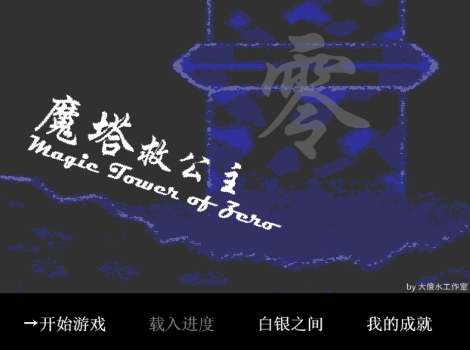
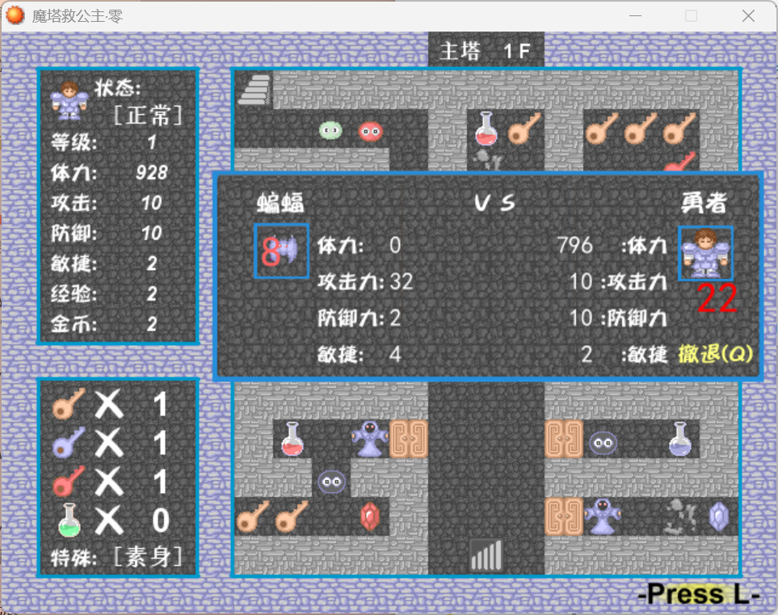
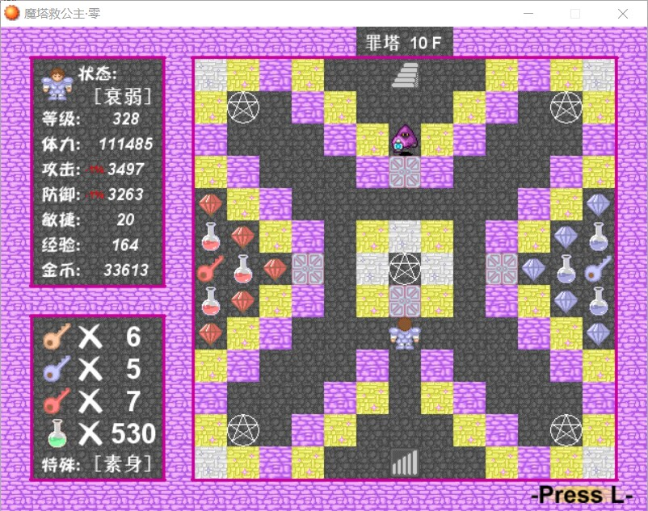

<div align="center">

# 魔塔救公主·零

**十种石像，多种搭配。走出属于你的救援路线。**

大傻水工作室出品 · 像素魔塔 · 石像组合 · 策略探索

[](https://github.com/BenJoang/Mota-save-princess-zero/releases/latest)   [](./LICENSE)

**[⬇ 下载最新版本](https://github.com/BenJoang/Mota-save-princess-zero/releases/latest)** &nbsp; · &nbsp; **[▶ 观看游戏实况](https://www.bilibili.com/video/BV1NR6JYuESB/)** &nbsp; · &nbsp; **[反馈问题](https://github.com/BenJoang/Mota-save-princess-zero/issues)**



[游戏亮点](#游戏亮点) · [画面预览](#画面预览) · [下载与开始](#下载与开始) · [制作团队](#制作团队)

</div>

## 游戏亮点

**《魔塔救公主·零》**，又名「魔塔救公主零」，也被称为「90」，是由大傻水工作室使用 **RPG Maker XP** 制作的魔塔游戏。脚本与玩法在借鉴《新新魔塔》特征的同时，加入了以**石像组合**为核心的设计。

| 🗿 十种石像 | ⚡ 主动 × 被动 | 🏰 经典中的新变化 |
| :--- | :--- | :--- |
| **10 种不同石像**，构成游戏的核心玩法。 | **5 种主动 + 5 种被动**，通过不同组合发挥意想不到的效果。 | 在熟悉的魔塔探索中，体验石像技能、战斗与地图交互。 |

**战斗不止看攻防。** 敏捷、暴击、怪物特殊能力与石像效果共同影响战局：蝙蝠的伤害回复、岩兽的攻防交换，或是史莱姆的敏捷提升，都能带来不同的战斗思路。

> **版本进度**：已发布[一周目正式版 v1.0.0](https://github.com/BenJoang/Mota-save-princess-zero/releases/tag/v1.0.0)。剧情设计分为一、二周目，二周目正在制作中，发布时间以之后的 [Releases](https://github.com/BenJoang/Mota-save-princess-zero/releases) 公告为准。

## 画面预览

### 从主塔出发，读懂每一场战斗

战斗界面展示勇者与怪物的体力、攻击、防御和敏捷信息；楼层中的钥匙、宝石与药水，则构成探索途中的资源选择。

<p align="center">
  
</p>

<details>
<summary><b>展开后期楼层画面 · 含地图与数值展示</b></summary>

<br>

<p align="center">
  
</p>

</details>

## 下载与开始

### 01 · 获取游戏

前往 **[最新版本下载页 →](https://github.com/BenJoang/Mota-save-princess-zero/releases/latest)**，在页面底部的 **Assets** 中选择 Windows 游戏压缩包。

当前 v1.0.0 的游戏包名称为：

```text
Mota-save-princess-zero-v1.0.0-Windows.zip
```

### 02 · 解压并启动

1. 将游戏压缩包**完整解压到一个单独的文件夹**。
2. 安装包内 `★必须安装的字体★` 文件夹中的两款字体：`STXINGKA.TTF`、`华康布丁体.TTF`。
3. 在解压后的游戏目录中运行 **`Game.exe`**。
4. 需要了解角色技能、怪物属性与相关机制时，可查阅包内的 **`信息说明.txt`**；其中包含技能获取位置等攻略信息，建议按需阅读。

> 请在解压完成后运行游戏，避免直接在压缩软件内启动。

### 03 · 遇到问题

<details>
<summary><b>应该下载游戏包，还是 Source code？</b></summary>

请选择 Assets 中的 **Windows 游戏压缩包**。`Source code (zip)`、`Source code (tar.gz)` 以及仓库的 `Code → Download ZIP` 是仓库快照，不是可直接游玩的游戏发行包。

</details>

<details>
<summary><b>文字显示异常或无法正常启动？</b></summary>

先确认游戏已完整解压，并按照包内说明安装所需字体。如果仍有问题，请通过 [Issues](https://github.com/BenJoang/Mota-save-princess-zero/issues) 反馈，并附上游戏版本、Windows 版本、报错截图及复现步骤。

</details>

<details>
<summary><b>想报告 Bug、提出建议或分享游玩反馈？</b></summary>

欢迎提交 [Issue](https://github.com/BenJoang/Mota-save-princess-zero/issues/new)。报告 Bug 时，建议说明所在楼层、触发条件、预期表现与实际表现；能够复现问题的截图或存档也会有帮助。

</details>

## 制作团队

从核心脚本、地图与石像设计，到剧情、传送逻辑与测试，本作由**大傻水工作室**的各位合作者共同完成。

| 成员 | 负责内容 |
| :--- | :--- |
| **大傻水** · [@BenJoang](https://github.com/BenJoang) | 核心代码编写：战斗、行动与地图内交互控制。 |
| **大傻E** · [B 站 / 卡路十里](https://space.bilibili.com/200729395) | 地图绘制、石像技能设计、怪物属性设计与剧情编写。 |
| **可酌** | 白银之间相关核心代码编写。 |
| **六级** | 测试与相关楼层传送代码编写。 |
| **冻手** | 游戏测试。 |
| **盐铁桶子** · [B 站 / 盐铁桶子](https://space.bilibili.com/8183775) | 游戏测试与宝贵的游玩意见；[观看相关游戏实况](https://www.bilibili.com/video/BV1NR6JYuESB/)。 |

## 许可与版权

本游戏采用 **[PolyForm Noncommercial License 1.0.0](./LICENSE)**，许可条款与版权通知分别见 [LICENSE](./LICENSE) 和 [NOTICE](./NOTICE)。商业使用须另行取得版权持有者的书面许可。

Copyright © 2025–2026 [大傻水（BenJoang）](https://github.com/BenJoang). All rights reserved except as expressly permitted under the PolyForm Noncommercial License 1.0.0.

---

<div align="center">

**感谢你走进这座魔塔。**

[下载游戏](https://github.com/BenJoang/Mota-save-princess-zero/releases/latest) · [更新记录](https://github.com/BenJoang/Mota-save-princess-zero/releases) · [交流与反馈](https://github.com/BenJoang/Mota-save-princess-zero/issues)

</div>
